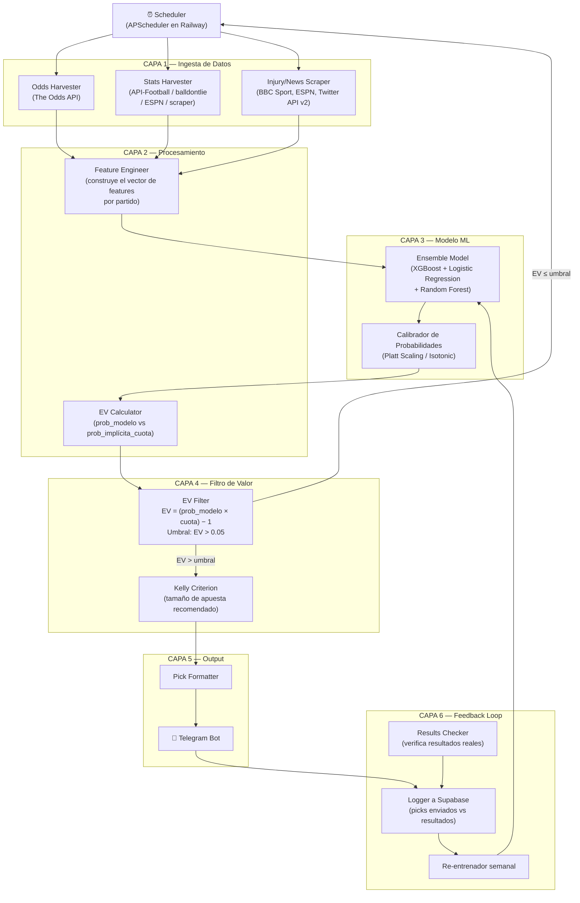
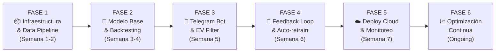
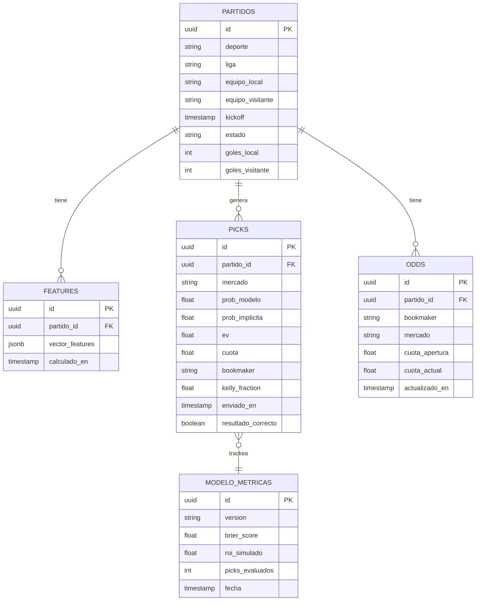

# 🤖 Bot de Pronósticos — Arquitectura Completa

> **Objetivo:** Máxima efectividad. Solo picks con edge real. Output por Telegram. 100% gratuito. Cloud-hosted.

---

## Principios de Diseño

> [!IMPORTANT]
> El bot **no envía picks porque quiere enviar** — solo dispara cuando el modelo detecta valor esperado positivo (EV+). Un día sin picks es un día ganador si no había edge real. Frecuencia ≠ efectividad.

Tres verdades que guían todo el sistema:

1. **La casa ya tiene el margen** — el único ángulo que funciona es detectar cuando la probabilidad real de un evento supera la probabilidad implícita en la cuota.
2. **Los datos en bruto no valen nada sin contexto** — lesiones, motivación, forma reciente, H2H, condiciones pesan más que el EGL histórico solo.
3. **El modelo se calibra con sus propios errores** — sin backtesting continuo, el bot es un generador de ruido.

---

## Stack Tecnológico (100% Gratuito)

| Componente | Herramienta | Tier gratuito |
|---|---|---|
| **Hosting + scheduler** | Railway / Render | 500h/mes free |
| **BD / almacenamiento** | Supabase (PostgreSQL) | 500MB free |
| **Lenguaje** | Python 3.11+ | — |
| **ML** | scikit-learn + XGBoost | — |
| **Odds en vivo** | The Odds API | 500 req/mes free |
| **Stats fútbol** | API-Football (RapidAPI free) | 100 req/día |
| **Stats fútbol alt.** | Football-Data.org | Free tier |
| **Stats basketball** | balldontlie.io | Completamente free |
| **Stats americano** | ESPN API (no-auth endpoints) | Completamente free |
| **Stats tenis** | Ultimate Tennis Stats (scraping) | — |
| **Scraping** | BeautifulSoup4 + httpx | — |
| **Output** | Telegram Bot API | Completamente free |
| **Orquestación** | APScheduler (cron interno) | — |
| **Monitoreo** | UptimeRobot | Free tier |

> [!NOTE]
> The Odds API free da 500 requests/mes. Con uso inteligente (solo ligas seleccionadas, 1-2 veces/día) alcanza para todo el mes. El límite más crítico a gestionar es API-Football: 100 req/día.

---

## Arquitectura del Sistema



---

## Features del Modelo (Lo que alimenta el ML)

El vector de features por partido se construye en estas categorías:

### 🔢 Features Cuantitativos
- Forma reciente (últimos 5, 10 partidos) — goles/puntos/sets a favor y en contra
- xG (Expected Goals) últimas 5 jornadas — fútbol
- Posición en tabla + puntos acumulados
- Promedio de goles/puntos en casa vs visita (separado)
- H2H histórico (últimos 5 enfrentamientos directos)
- Racha actual (victorias/derrotas consecutivas)
- Días de descanso desde último partido
- Distancia viajada (visitante)

### 🏥 Features Contextuales
- Número de titulares lesionados (con peso por posición)
- ¿Juega titular el capitán/estrella?
- Clima (temperatura, lluvia) — para fútbol outdoor
- Importancia del partido (¿necesitan ganar para clasificar?)
- Fatiga acumulada (partidos en los últimos 14 días)

### 📊 Features de Mercado
- Cuota de apertura vs cuota actual (movimiento de línea)
- % de apuestas públicas vs % de dinero (cuando disponible)
- Varianza de cuotas entre casas (indica incertidumbre del mercado)

### 🎯 Target Variable
- **Resultado real del partido** (1X2, Over/Under, BTTS según el mercado con mejor EV detectado)

---

## Mercados Que el Bot Evalúa

El bot no tiene mercado favorito — evalúa cuál tiene mayor EV en cada partido:

| Mercado | Cuándo tiene más edge |
|---|---|
| **1X2** | Cuando el movimiento de línea es fuerte hacia un lado |
| **Over/Under goles** | Alta correlación con xG de ambos equipos |
| **BTTS (ambos anotan)** | Cuando ambos equipos tienen xG alto y defensa débil |
| **Hándicap asiático** | Partidos muy desiguales donde el spread da valor |
| **Moneyline NBA/NFL** | Cuando el modelo diverge >8% de la probabilidad implícita |
| **Total puntos NBA** | Alta efectividad con ritmo de posesiones + pace stats |

---

## Lógica de Decisión — EV Filter

```
prob_modelo    = salida calibrada del ensemble (ej: 0.58)
cuota_decimal  = mejor cuota entre bookmakers (ej: 2.10)
prob_implícita = 1 / cuota_decimal           (ej: 0.476)

EV = (prob_modelo × cuota_decimal) - 1
EV = (0.58 × 2.10) - 1 = 0.218 - 1 = -0.782... ESPERA

--- corrección ---

EV = prob_modelo × (cuota_decimal - 1) - (1 - prob_modelo)
EV = 0.58 × 1.10 - 0.42 = 0.638 - 0.42 = 0.218  ✅ PICK VÁLIDO
```

**Umbral mínimo:** EV > 0.05 (5% de edge mínimo)
**Kelly fraction:** `f = (prob × cuota - 1) / (cuota - 1)` × 0.25 *(quarter Kelly — reduce riesgo de ruina)*

---

## Fases de Construcción



### FASE 1 — Infraestructura & Data Pipeline

**Objetivo:** Tener datos fluyendo y almacenándose.

- [ ] Setup Supabase — esquema de tablas (partidos, features, picks, resultados)
- [ ] Setup Railway / Render — entorno Python
- [ ] Scraper/harvester para The Odds API — odds de los mercados objetivo
- [ ] Harvester para API-Football — stats de fútbol (forma, H2H, standings)
- [ ] Harvester para balldontlie — stats NBA
- [ ] Harvester ESPN endpoints no-auth — NFL, otros deportes
- [ ] Sistema de rate-limiting y caché para no quemar las cuotas de API gratis
- [ ] Colección histórica inicial (backfill de al menos 1 temporada)

**Deliverable:** Pipeline que corre en cron, almacena datos, no falla silenciosamente.

---

### FASE 2 — Modelo Base & Backtesting

**Objetivo:** Un modelo que ya supera el baseline de predicción aleatoria.

- [ ] Feature engineering pipeline (construye el vector por partido)
- [ ] Split temporal train/test (nunca random split en datos de deportes — hay leakage)
- [ ] Entrenar Logistic Regression como baseline
- [ ] Entrenar XGBoost + Random Forest
- [ ] Calibración de probabilidades (Platt Scaling)
- [ ] Backtesting histórico con EV filter — simular picks pasados
- [ ] Métricas objetivo: **Brier Score < 0.22**, **ROI simulado > 5% sobre umbral EV=0.05**
- [ ] Feature importance analysis — eliminar ruido

**Deliverable:** Notebook de backtesting con curva de bankroll histórica.

---

### FASE 3 — Telegram Bot & EV Filter

**Objetivo:** El output llega a tu teléfono con formato limpio.

- [ ] Crear bot en Telegram (@BotFather)
- [ ] Implementar EV Calculator
- [ ] Implementar Kelly Criterion (quarter Kelly)
- [ ] Formatter de picks — formato de mensaje estándar
- [ ] Lógica de supresión — no enviar si EV < umbral, sin importar cuántos días han pasado
- [ ] Comando `/stats` — retorna métricas de rendimiento acumulado
- [ ] Comando `/bankroll` — estado del bankroll actual

**Formato de pick en Telegram:**
```
🎯 PICK DETECTADO

🏆 Liga: Premier League
⚽ Partido: Arsenal vs Chelsea
📅 Kickoff: 15 Nov 2026 — 15:00h

Mercado: Over 2.5 Goles
Cuota: 1.87 @ Bet365 (mejor disponible)
Prob. modelo: 64.2%
Prob. implícita: 53.5%
Edge (EV): +19.8% ✅

💰 Kelly recomendado: 2.3% del bankroll
⚠️ Confianza: ALTA (ensemble unánime)

— Solo juega si tienes acceso a esa cuota.
```

---

### FASE 4 — Feedback Loop & Auto-retrain

**Objetivo:** El bot aprende de sus errores sin intervención manual.

- [ ] Results Checker — cron post-partido que busca resultado real
- [ ] Logger — guarda pick enviado + resultado + EV real post-facto
- [ ] Dashboard de rendimiento (tabla en Supabase, consultas via `/stats`)
- [ ] Re-entrenador semanal con datos nuevos
- [ ] Alertas si el Brier Score empieza a degradarse (modelo en drift)

---

### FASE 5 — Deploy Cloud & Monitoreo

**Objetivo:** El bot corre solo, sin que toques la PC.

- [ ] Dockerfile + railway.json configurado
- [ ] Variables de entorno (API keys en Railway secrets)
- [ ] APScheduler configurado con todos los cron jobs
- [ ] UptimeRobot apuntando al health endpoint del servicio
- [ ] Alertas en Telegram si el bot muere o hay error crítico

**Cron jobs del sistema:**

| Job | Frecuencia | Función |
|---|---|---|
| `harvest_odds` | Cada 6h | Recolecta cuotas actualizadas |
| `harvest_stats` | 1x/día 06:00 UTC | Stats y lesiones |
| `run_predictions` | 2x/día 07:00 + 12:00 UTC | Genera y filtra picks |
| `check_results` | 1x/día 02:00 UTC | Verifica resultados del día anterior |
| `retrain_model` | Lunes 03:00 UTC | Re-entrena con datos de la semana |

---

### FASE 6 — Optimización Continua

**Objetivo:** Subir el edge real. Nunca se termina.

- [ ] A/B testing de umbrales EV (¿conviene 0.05 o 0.08?)
- [ ] Agregar modelos específicos por deporte (un XGBoost para fútbol, otro para NBA)
- [ ] Incorporar movimiento de línea como feature predictivo
- [ ] Explorar modelos de Poisson para predicción de goles (fútbol)
- [ ] Explorar redes neuronales (PyTorch — solo si el ensemble base ya es sólido)
- [ ] Expandir a nuevos mercados si el backtest lo justifica

---

## Esquema de Base de Datos (Supabase)



---

## Riesgos y Mitigaciones

| Riesgo | Probabilidad | Mitigación |
|---|---|---|
| API-Football se agota (100 req/día) | Alta | Caché agresivo, solo ligas top 5, rate limiter |
| The Odds API se agota (500 req/mes) | Media | Harvest selectivo, solo días con partidos |
| Modelo en drift (resultados reales vs predichos divergen) | Media | Monitor Brier Score semanal, alert automático |
| Railway duerme el servicio (inactividad) | Alta | UptimeRobot ping cada 10 min, o Render con cron job |
| Overfitting en backtesting | Alta | Split temporal estricto, walk-forward validation |

---

## Lo Que Este Bot NO Es

> [!CAUTION]
> El bot predice **valor esperado**, no resultados garantizados. El edge del 5-15% significa que en el largo plazo ganas — no que cada pick es ganador. La gestión de bankroll (Kelly) es tan importante como el modelo. Sin disciplina en el sizing, el mejor modelo del mundo te lleva a ruina.

---

## Resumen de la Pila Final

```
Railway (cloud host)
  └── Python 3.11
       ├── APScheduler (cron)
       ├── Harvesters (httpx + BS4)
       │    ├── The Odds API
       │    ├── API-Football
       │    ├── balldontlie (NBA)
       │    └── ESPN endpoints
       ├── Feature Engineer
       ├── Ensemble ML (XGBoost + LR + RF)
       ├── EV + Kelly Filter
       └── Telegram Bot API
            └── Tu teléfono 📱

Supabase (PostgreSQL)
  ├── partidos
  ├── features
  ├── picks
  ├── odds
  └── modelo_metricas
```
